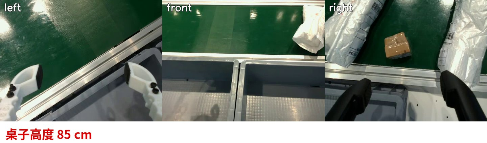
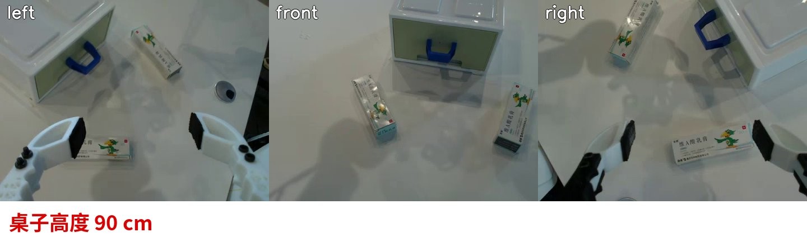

# 异步真机推理：把指定模型路径跑起来

适用于任意 π0.5 checkpoint。00108 step6300 只是其中一个例子。负责人告诉实习生模型目录，实习生按下面的顺序把这个路径写进推理 YAML，再起服务和客户端。

操作机器是 `gpu-master`。从 CIGAI22 登录：

```bash
ssh -t xk@gpu-master
```

`-t` 要保留。Ctrl+. 和评价输入都在这个 SSH 终端里。三个相机窗口出现在 gpu-master 的屏幕上，不到 CIGAI22。

不要执行 `recipes/pi05/launch_pi05_server.sh`。它会杀掉所有 `serve_tong_pi05.py`。

## 1. 认出模型目录

负责人给的路径有两种，都先化成同一个根目录 `CKPT`。`CKPT` 下面必须同时有这三样：

- `train.yaml`：训练配置，推理字段从这里抄
- `assets/`：这份权重的归一化统计
- `pretrained_model/model.safetensors`：权重要加载的文件

```bash
# 若给的是 .../step006300
CKPT=/path/to/step006300
# 若给的是 .../step006300/pretrained_model，改成上一级
# CKPT=$(dirname /path/to/step006300/pretrained_model)

test -f "$CKPT/train.yaml" && test -d "$CKPT/assets" && test -f "$CKPT/pretrained_model/model.safetensors" && echo OK
```

`OK` 没打出来就不要往下走，把缺的那一项发给负责人。`ckpt_dir` 必须指到 `pretrained_model`，不能指到 `CKPT` 本身。服务端只在 `ckpt_dir` 里找 `model.safetensors`，归一化只在 `ckpt_dir` 的上一级 `assets/` 里找。

## 2. 一条命令生成推理 YAML

不用复制模板，也不用手改字段。真机的相机、机械臂、脚踏板留在模板里；模型路径、`config_name`、动作块长度、delta、夹爪交错、`adapt_to_pi`、相机名和 prompt 由脚本从 `CKPT/train.yaml` 写入。

```bash
/home/xk/miniconda3/envs/lingbotva/bin/python /home/xk/data_Driven/recipes/pi05/apply_ckpt_infer_yaml.py "$CKPT"
```

换任务句放在后面的「改推理参数」。1242 上已经是别的模型时，加 `--port 空端口`。脚本会把 YAML 里的端口和服务命令写成同一个数。

生成的 YAML 是 `infer/infer/config/lerobot/pi05_<目录名>_ws.yaml`。结果目录是 `$CKPT/inference/`。下面两条命令用的就是这个文件。用了 `--port` 时，把 `1242` 换成那个端口。

```bash
RUN_YAML=/home/xk/data_Driven/infer/infer/config/lerobot/pi05_$(basename "$CKPT")_ws.yaml
PORT=1242
```

## 3. 起服务端

服务端才加载权重。客户端不读 `model.safetensors`。先看这个端口上是不是已经是本次模型；已经是就不要重启。

```bash
ss -ltnp | grep ":${PORT}"
```

没有进程时执行：

```bash
cd /home/xk/data_Driven && \
OPENPI_DISABLE_TORCH_COMPILE=1 XLA_PYTHON_CLIENT_PREALLOCATE=false \
PYTHONPATH=/home/xk/data_Driven/infer \
nohup /home/xk/VLA/openpi/cigai-agilex-train-openpi/.venv/bin/python -u \
  /home/xk/data_Driven/recipes/pi05/serve_tong_pi05.py \
  --config "$RUN_YAML" \
  --port "$PORT" \
  > /home/xk/data_Driven/recipes/pi05/server_$(basename "$CKPT").log 2>&1 &
```

日志里出现 `model ready` 才算权重加载成功。核对 `config=`、`action_horizon=`、`adapt_to_pi`、`delta_action_dims`、`interleave_grippers`，以及 `assets` 路径在 `$CKPT/assets`。出现「权重未就绪」或「未找到 norm stats」就停，不要开客户端。

```bash
tail -n 30 /home/xk/data_Driven/recipes/pi05/server_$(basename "$CKPT").log
```

## 4. 起客户端

在同一个 SSH 终端里执行：

```bash
cd /home/xk/data_Driven/infer && PYTHONPATH=/home/xk/data_Driven/infer \
  /home/xk/miniconda3/envs/lingbotva/bin/python -m infer.cli.run_async_infer \
  --config "$RUN_YAML"
```

这条命令选中异步执行。推理 YAML 里的 `engine: native` 不会把它改回同步开环。

成功的标志：

- 日志有 `[INFO] 任务:`，文字和 `task_prompt` 一致
- 随后出现「等待 Ctrl+. 开始第 1 个任务段」
- 服务端日志出现客户端 `connected`

按键：

- **Ctrl+.** 开始一段。先回到标准初始位，再向服务端要动作块。
- 再按一次 **Ctrl+.** 结束这一段。
- 一组段数是 YAML 里的 `tasks_per_group`。
- 等待画面里按 Y 不会开始。Y 只在外骨骼对齐确认，或终端真的印出「是否继续」时使用。

## 改推理参数

不要手改生成出来的 YAML。再跑一次生成命令会按训练配置重写模型字段。这次要保留的 prompt、频率、段数要在命令里一起写上。

只重开客户端，服务不用动。先在客户端终端按 **Ctrl+C**，用下面对应数据集的命令改任务句，再执行第 4 步。`--fps` 是控制环频率，`--tasks-per-group 12` 表示这一组 12 段，跑完客户端退出。

73：绿色传送带上的白色快递袋放进左边箱子，棕色快递盒放进右边箱子。下图是 `episode_000000` 的第一帧，从左到右是 left、front、right。<span style="color:red">桌子高度 85 cm</span>



```bash
/home/xk/miniconda3/envs/lingbotva/bin/python /home/xk/data_Driven/recipes/pi05/apply_ckpt_infer_yaml.py "$CKPT" \
  --prompt "Using both hands, pick up the courier items from the green conveyor belt. Place the white courier bags into the left box and the brown courier boxes into the right box."
```

108：黄香蕉和黄柠檬放进黑盒，绿蔬菜放进蓝盒。下图是 `episode_000000` 的第一帧。<span style="color:red">桌子高度 85 cm</span>


```bash
/home/xk/miniconda3/envs/lingbotva/bin/python /home/xk/data_Driven/recipes/pi05/apply_ckpt_infer_yaml.py "$CKPT" \
  --prompt "With both hands, pick up the yellow banana and the yellow lemon and put them into the black box; then take the green vegetables and place them into the blue box."
```

91：左手拉开蓝色把手的抽屉，右手取出白色药盒放进绿色抽屉，再关上。下图是 `episode_000000` 的第一帧。<span style="color:red">桌子高度 90 cm</span>



```bash
/home/xk/miniconda3/envs/lingbotva/bin/python /home/xk/data_Driven/recipes/pi05/apply_ckpt_infer_yaml.py "$CKPT" \
  --prompt "Using both hands, pull open the drawer with the blue handle using your left hand, take out the white medicine box with your right hand, place it into the green drawer, and finally close the drawer."
```

任务句、控制频率、调用间隔都在客户端 YAML 里，改完只重启客户端：

- `policy.task_prompt`：任务句。生成命令的 `--prompt` 会写进这里。
- `session.fps`：控制环频率。生成命令的 `--fps` 会写进这里。现在是 15。
- `session.replan_steps`：两次模型调用之间的控制步数。生成命令的 `--replan-steps` 会写进这里。写成 `null` 时用动作块长度的五分之一；50 步的块就是 10 步。

客户端启动命令不用再带这三项。

换端口或换模型要停掉旧服务再按第 3 步重新起。端口用 `--port`。`config_name`、动作块长度、delta、夹爪交错、`adapt_to_pi` 跟训练对齐，不要改。去噪步数由服务端默认 10 步，这条命令改不到。

换另一个模型：从第 1 步重做。旧服务还要留着时不要杀它，端口用 `--port` 避开。

## 5. 跑起来之后动作块怎么发

控制频率是 `session.fps`（模板是 15 Hz）。每次只发缓存里的一步。一块的长度是 `action_horizon`。同一时间只有一次推理。

新块到达以后：

1. 旧块没发完的步丢掉。
2. 新块从下标 `round(这次推理秒数 × fps)` 开始发。推理 0.2 秒、15 Hz 时，第一条是 `chunk[3]`。日志 `index=3` 就是这一帧。
3. 装进缓存后再等 `session.replan_steps` 个控制步才提交下一次。该值为 `null` 时用动作块长度的五分之一。50 步、15 Hz 时是 10 步，约 0.67 秒。

旧块在被换掉前大约再发 `(再规划秒数 + 推理秒数) × fps` 步。新块的起始下标只由推理秒数决定，不把再规划的等待算进去。第一段没有旧块：结果返回前手臂停着，返回后直接发新块的那个下标。
